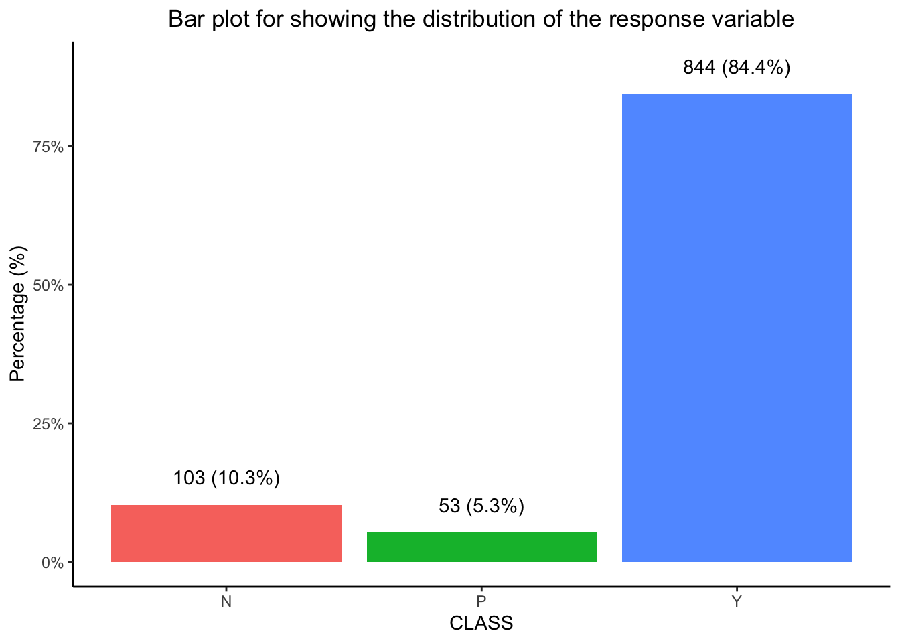
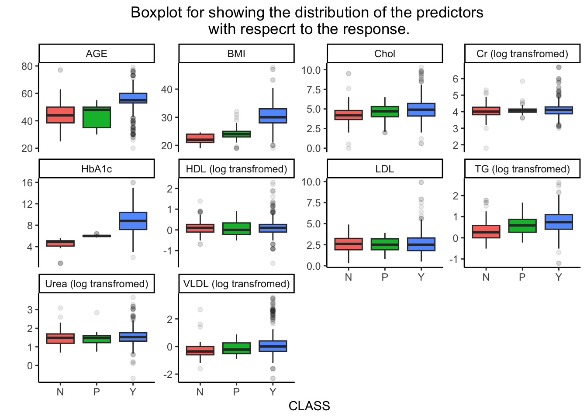
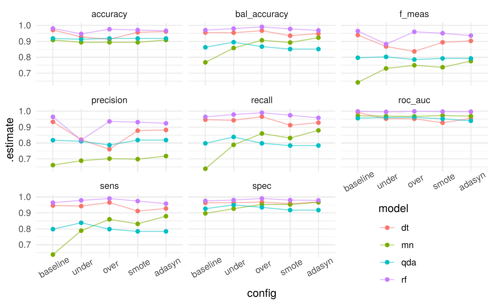

# Predicting Pre-Diabetes Under Class Imbalance

Which patients are heading toward diabetes but have not been diagnosed yet? In this dataset that "predicted diabetic" group is only about 5% of patients, so a model can score high accuracy while missing nearly all of them. This project compares four classifiers under five ways of handling the imbalance, all built with tidymodels.

Course project for a graduate machine learning course (Data Driven Methods) at Baylor University, Summer 2025.



*Class distribution in the raw data: N = non-diabetic, P = predicted diabetic, Y = diabetic.*

## Data

[Diabetes Dataset](https://data.mendeley.com/datasets/wj9rwkp9c2/1) (Rashid, 2020, Mendeley Data): 1,000 patient records from two Iraqi hospitals with age, gender, BMI, HbA1c, urea, creatinine and a lipid profile, labelled non-diabetic (N), predicted diabetic (P) or diabetic (Y). After dropping identifiers and exact duplicate rows, 826 records remain, split 75/25 into training and test sets with stratification on class.



## Method

Every combination of model and resampling scheme is fitted as a tidymodels workflow:

| Models | Imbalance handling |
|---|---|
| Multinomial logistic regression (`nnet`) | None (baseline) |
| Quadratic discriminant analysis (`MASS`) | Random over-sampling |
| Decision tree (`rpart`) | Random under-sampling |
| Random forest (`ranger`) | SMOTE |
| | ADASYN |

- Resampling is a recipe step (`themis`), so it is applied inside each cross-validation fold and never touches the assessment data.
- The resampling ratio, the number of neighbours for SMOTE/ADASYN and each model's own hyperparameters are tuned together by random search over 10-fold stratified cross-validation.
- The best configuration is refitted on the training set and scored once on the held-out test set with accuracy, balanced accuracy, F-measure, precision, recall, sensitivity, specificity and ROC AUC.
- Tuning runs in parallel with `future`.

## Results



*Test-set metrics for each model (dt = decision tree, mn = multinomial, qda = QDA, rf = random forest) under each resampling scheme.*

- **Random forest** was the strongest model on nearly every metric, with or without resampling.
- **Resampling helped the linear model most.** Multinomial regression went from a recall of roughly 0.64 at baseline to roughly 0.8–0.9 with resampling, at little cost in specificity.
- **Tree-based models were less sensitive** to the resampling choice, and plain under-sampling hurt the decision tree's precision.

The minority class has only a few dozen patients, so about a dozen land in the test set and these differences carry real uncertainty; repeated cross-validation would be the next step before drawing firm conclusions.

## Repository layout

```
fit_models.R    tunes and fits all 20 model × resampling combinations, saving each to model/
analysis.qmd    exploratory analysis, per-model results and the comparison figure
data/           download instructions for the dataset
model/          fitted workflows are written here (not tracked)
figures/        figures used in this README
```

## Reproducing

```r
install.packages(c("tidyverse", "tidymodels", "themis", "discrim", "future",
                   "nnet", "MASS", "rpart", "ranger", "glue", "here"))
```

1. Download the dataset as described in [data/README.md](data/README.md).
2. Run `fit_models.R` from the repository root. It takes a while; it uses all but two cores.
3. Render the report: `quarto render analysis.qmd`.

## Skills demonstrated

R · tidymodels (recipes, workflows, tune, yardstick) · class-imbalance methods (over/under-sampling, SMOTE, ADASYN) · hyperparameter tuning with cross-validation · classification model comparison · parallel computing · ggplot2 · Quarto

## Author

Nishith Ranjon Roy (Pritom) · [LinkedIn](https://www.linkedin.com/in/pritom65/) · [Google Scholar](https://scholar.google.com.pk/citations?user=HjqFwTUAAAAJ&hl=en)
